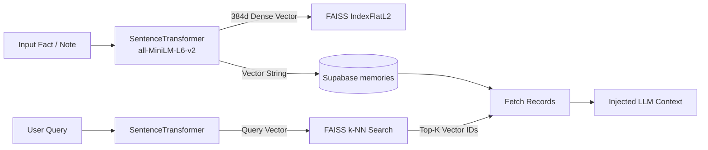
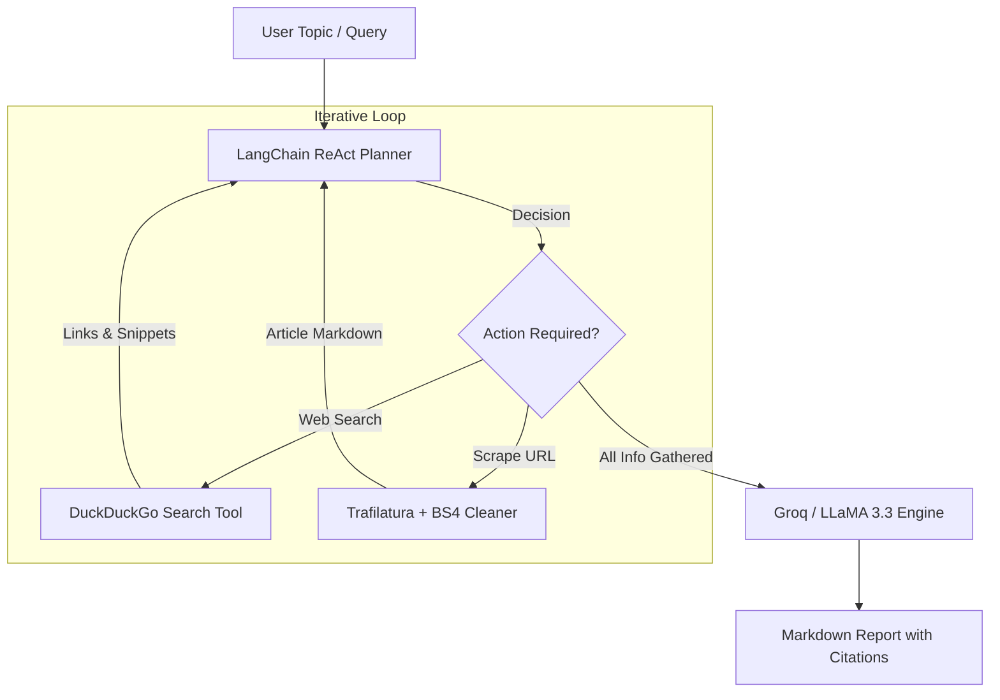
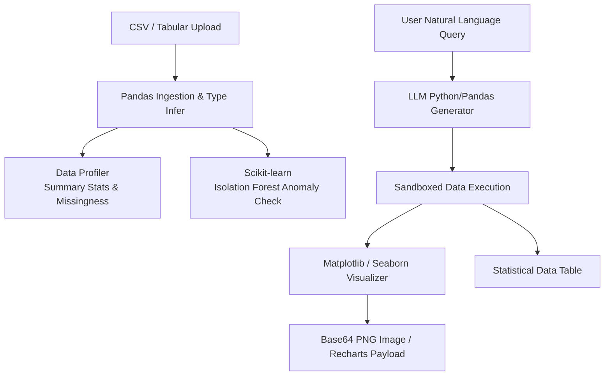

# Vectronyx AI Workbench — AI Engines Deep Dive

Vectronyx is powered by three autonomous, decoupled AI engines that operate seamlessly together: the **Contextual Memory System**, the **Autonomous Research Agent**, and the **Intelligent Data Analyst**.

---

## 1. Contextual Memory System (`backend/app/modules/memory/`)

The Memory System provides long-term recall, enabling Vectronyx to remember user facts, preferences, research histories, and cross-session insights.



### 1.1 Components

| Component | File Path | Technology | Responsibility |
| :--- | :--- | :--- | :--- |
| **Embedder** | `modules/memory/embedder.py` | `sentence-transformers` | Converts raw text into normalized 384-dimensional dense vectors. |
| **Memory Store** | `modules/memory/memory_store.py` | `faiss-cpu`, `numpy` | Manages local FAISS index (`IndexFlatL2` or `IndexIDMap`), persistence, and nearest-neighbor vector queries. |
| **Relational Sync** | `db/repositories/memory_repo.py` | `SQLAlchemy`, Supabase | Persists user IDs, text content, timestamps, and embedding arrays in PostgreSQL. |
| **Schemas** | `modules/memory/schemas.py` | `pydantic` | Defines Pydantic validation contracts for memory creation, search filters, and results. |

### 1.2 Memory Lifecycle

1. **Ingestion & Indexing**:
   - The user or agent emits a memory string: `"User prefers concise summaries in bullet points"`.
   - The `MemoryEmbedder` generates a 384-dimensional float vector:
     ```python
     embedding = model.encode(text).tolist()
     ```
   - The vector is indexed into FAISS (`index.add(vector)`), and the index is serialized to `vector_store/index.faiss`.
   - The text and vector are saved to the `memories` table in PostgreSQL.

2. **Semantic Search & Retrieval**:
   - Given a query: `"How should I format this response?"`
   - The query is embedded, and FAISS returns the $K$ closest vectors by Euclidean distance:
     ```python
     distances, indices = faiss_index.search(query_vector, k=3)
     ```
   - Matched memory items are retrieved and formatted as system context for the LLM prompt.

---

## 2. Autonomous Research Agent (`backend/app/modules/research_agent/`)

The Research Agent conducts autonomous web investigations, gathers intelligence from multiple sources, extracts high-signal content, and synthesizes structured reports with citations.



### 2.1 Components

| Component | File Path | Technology | Responsibility |
| :--- | :--- | :--- | :--- |
| **Agent Controller** | `modules/research_agent/agent.py` | `langchain`, `langchain-groq` | Manages the ReAct execution loop, state transitions, and step limits. |
| **Search & Scrape Tools** | `modules/research_agent/tools.py` | `duckduckgo-search`, `trafilatura` | Discovers search results and extracts clean article text, stripping navigation, ads, and CSS. |
| **Prompt Engineering** | `modules/research_agent/prompts.py` | Template strings | Custom system instructions enforcing objective synthesis, factual grounding, and standard citation formats. |
| **Data Contracts** | `modules/research_agent/schemas.py` | `pydantic` | Request models (`ResearchRequest`, `ResearchDepth`) and response models (`ResearchResult`, `SourceItem`). |

### 2.2 Deep Scrape Engine
Standard HTML fetchers suffer from noisy boilerplates, paywalls, and cookies. Vectronyx uses `trafilatura` combined with `beautifulsoup4`:
- **Content Hygiene**: Strips `<script>`, `<style>`, `<nav>`, `<footer>`, and advertising widgets.
- **Metadata Extraction**: Extracts author, publication date, and canonical source URL.
- **Token Economy**: Compresses long articles into clean markdown paragraphs, keeping context windows lean.

---

## 3. Intelligent Data Analyst (`backend/app/modules/data_analyst/`)

The Data Analyst engine enables users to upload tabular data (CSV, TSV, JSON) and interact with it through natural language, automated statistical summaries, anomaly detection, and chart generation.



### 3.1 Components

| Component | File Path | Technology | Responsibility |
| :--- | :--- | :--- | :--- |
| **Analyst Core** | `modules/data_analyst/analyst.py` | `pandas`, `scipy` | Performs schema profiling, quantile calculations, correlation matrices, and filtering. |
| **Anomaly Detector** | `modules/data_analyst/analyst.py` | `scikit-learn` | Runs unsupervised `IsolationForest` to flag multivariate outliers. |
| **Visualizer** | `modules/data_analyst/analyst.py` | `matplotlib`, `seaborn` | Plots histograms, scatter matrices, and heatmaps; converts figures to base64 images. |
| **Prompt Engine** | `modules/data_analyst/prompts.py` | Template strings | Generates executable Pandas transformations from user questions. |
| **Schemas** | `modules/data_analyst/schemas.py` | `pydantic` | Structured types for column metrics, charts, anomaly scores, and dataset summaries. |

---

## 4. LLM & Inference Architecture

Vectronyx supports dynamic provider switching between cloud-accelerated inference and local, private execution:

### 4.1 Groq Cloud Provider (`groq`, `langchain-groq`)
- **Default Model**: `llama-3.3-70b-versatile`
- **Strengths**: Near-instantaneous response generation (~200-300 tokens/sec), zero GPU load on local machine, optimal for complex ReAct agent loops.
- **Configuration**: Set `LLM_PROVIDER=groq` and supply `GROQ_API_KEY`.

### 4.2 Ollama Local Provider (`ollama`)
- **Default Model**: `llama3:latest` (or `llama3.3`)
- **Strengths**: 100% offline, zero data leaves local network, free of API costs and rate limits.
- **Configuration**: Set `LLM_PROVIDER=ollama` and set `OLLAMA_BASE_URL=http://localhost:11434`.
- **Command to pull model**:
  ```bash
  ollama run llama3
  ```
