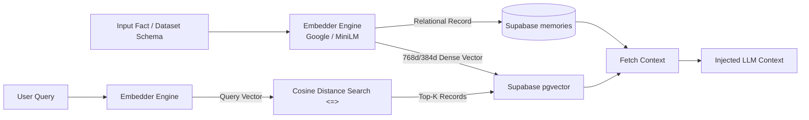
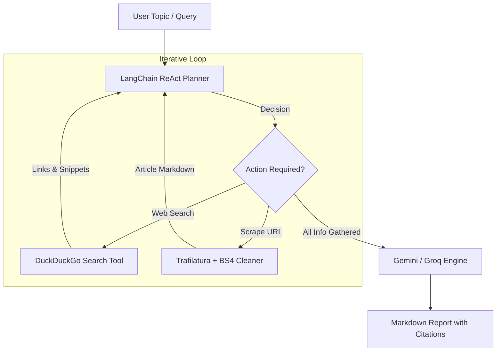
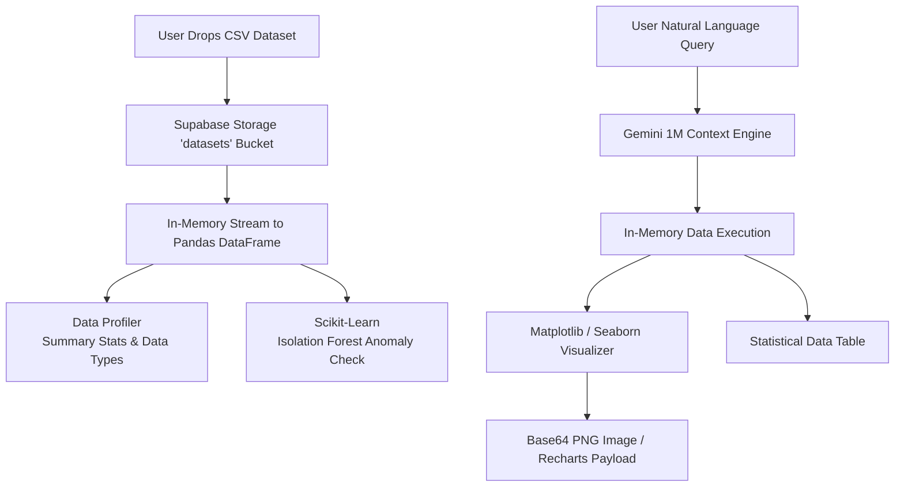

# Vectronyx AI Workbench — AI Engines Deep Dive

Vectronyx is powered by three autonomous, decoupled AI engines that operate seamlessly together: the **Contextual Memory System**, the **Autonomous Research Agent**, and the **Intelligent Data Analyst**.

---

## 1. Contextual Memory System (`backend/app/modules/memory/`)

The Memory System provides long-term recall, enabling Vectronyx to remember user facts, preferences, research histories, and cross-session insights.



### 1.1 Components

| Component | File Path | Technology | Responsibility |
| :--- | :--- | :--- | :--- |
| **Embedder** | `modules/memory/embedder.py` | Google / Sentence-Transformers | Converts raw text and schema tokens into normalized dense vectors. |
| **Memory Store** | `modules/memory/memory_store.py` | `pgvector`, `SQLAlchemy` | Executes cosine similarity searches (`<=>`) directly within PostgreSQL. |
| **Relational Sync** | `db/repositories/memory_repo.py` | `SQLAlchemy`, Supabase | Persists user IDs, text content, timestamps, and vector embeddings in PostgreSQL. |
| **Schemas** | `modules/memory/schemas.py` | `pydantic` | Defines Pydantic validation contracts for memory creation, search filters, and results. |

### 1.2 Memory Lifecycle

1. **Ingestion & Indexing**:
   - The user or agent emits a memory or schema note: `"Column 'churn' indicates 30-day user inactivity"`.
   - The embedder generates a dense vector:
     ```python
     embedding = get_embedding(text)
     ```
   - The vector is inserted directly into the PostgreSQL table using `pgvector`:
     ```sql
     INSERT INTO memories (user_id, content, embedding) VALUES (:user_id, :content, :embedding);
     ```

2. **Semantic Search & Retrieval**:
   - Given a query: `"What does the churn column mean?"`
   - The query vector is matched against stored memories using native cosine distance:
     ```sql
     SELECT content FROM memories ORDER BY embedding <=> :query_vector LIMIT 3;
     ```
   - Matched memory items are retrieved and formatted as system context for the LLM prompt.

---

## 2. Autonomous Research Agent (`backend/app/modules/research_agent/`)

The Research Agent conducts autonomous web investigations, gathers intelligence from multiple sources, extracts high-signal content, and synthesizes structured reports with citations.



### 2.1 Components

| Component | File Path | Technology | Responsibility |
| :--- | :--- | :--- | :--- |
| **Agent Controller** | `modules/research_agent/agent.py` | `langchain`, `langchain-groq` | Manages the ReAct execution loop, state transitions, and step limits. |
| **Search & Scrape Tools** | `modules/research_agent/tools.py` | `duckduckgo-search`, `trafilatura` | Discovers search results and extracts clean article text, stripping navigation, ads, and CSS. |
| **Prompt Engineering** | `modules/research_agent/prompts.py` | Template strings | Custom system instructions enforcing objective synthesis, factual grounding, and standard citation formats. |
| **Data Contracts** | `modules/research_agent/schemas.py` | `pydantic` | Request models (`ResearchRequest`, `ResearchDepth`) and response models (`ResearchResult`, `SourceItem`). |

### 2.2 Deep Scrape Engine
Standard HTML fetchers suffer from noisy boilerplates, paywalls, and cookies. Vectronyx uses `trafilatura` combined with `beautifulsoup4`:
- **Content Hygiene**: Strips `<script>`, `<style>`, `<nav>`, `<footer>`, and advertising widgets.
- **Metadata Extraction**: Extracts author, publication date, and canonical source URL.
- **Token Economy**: Compresses long articles into clean markdown paragraphs, keeping context windows lean.

---

## 3. Intelligent Data Analyst (`backend/app/modules/data_analyst/`)

The Data Analyst engine enables users to upload tabular data (CSV, TSV, JSON) and interact with it through natural language, automated statistical summaries, anomaly detection, and chart generation.



### 3.1 Components

| Component | File Path | Technology | Responsibility |
| :--- | :--- | :--- | :--- |
| **Cloud Ingestion** | `modules/data_analyst/analyst.py` | `supabase`, `pandas` | Downloads dataset streams from Supabase Storage directly into memory (zero local disk persistence). |
| **Analyst Core** | `modules/data_analyst/analyst.py` | `pandas`, `scipy` | Performs schema profiling, quantile calculations, correlation matrices, and filtering. |
| **Anomaly Detector** | `modules/data_analyst/analyst.py` | `scikit-learn` | Runs unsupervised `IsolationForest` to isolate multivariate outliers. |
| **Visualizer** | `modules/data_analyst/analyst.py` | `matplotlib`, `seaborn` | Plots histograms, scatter matrices, and heatmaps; converts figures to base64 images. |
| **Prompt Engine** | `modules/data_analyst/prompts.py` | Template strings | Generates executable Pandas transformations from user questions. |
| **Schemas** | `modules/data_analyst/schemas.py` | `pydantic` | Structured types for column metrics, charts, anomaly scores, and dataset summaries. |

---

## 4. Cloud LLM & Inference Architecture

Vectronyx utilizes a 100% cloud-native inference architecture combining massive context reasoning with sub-second LPU speed:

### 4.1 Google Gemini Provider (`google-genai`)
- **Active Model**: `gemini-3.5-flash-lite` (or `gemini-3.8-flash`)
- **Strengths**: 1,000,000 token context window, deep data reasoning, schema ingestion, and structured Python code generation.
- **Configuration**: Set `LLM_PROVIDER=gemini` and supply `GEMINI_API_KEY`.

### 4.2 Groq Cloud Provider (`groq`, `langchain-groq`)
- **Active Model**: `openai/gpt-oss-120b` (or `qwen/qwen3.8-27b`)
- **Strengths**: Near-instantaneous response generation (~250 tokens/sec) on specialized LPUs, ideal for natural language Q&A and fast tool iterations.
- **Configuration**: Set `LLM_PROVIDER=groq` and supply `GROQ_API_KEY`.

