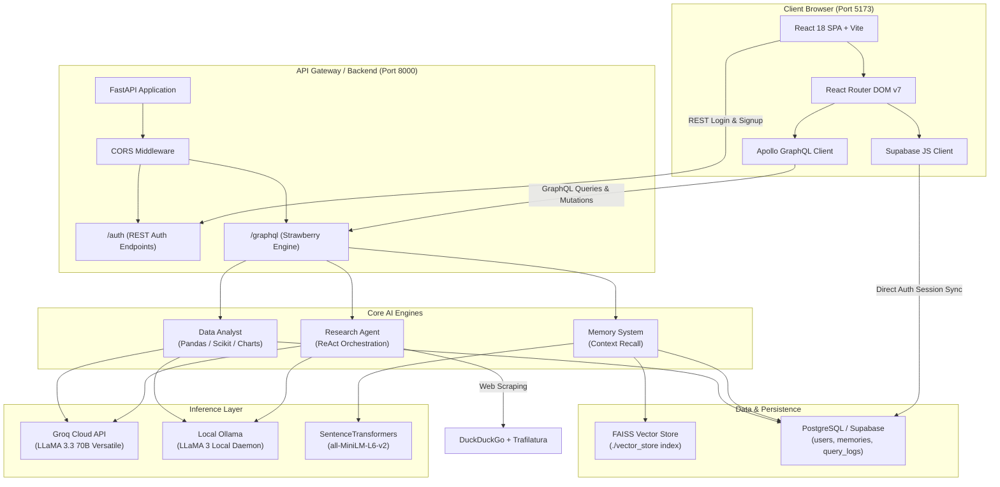
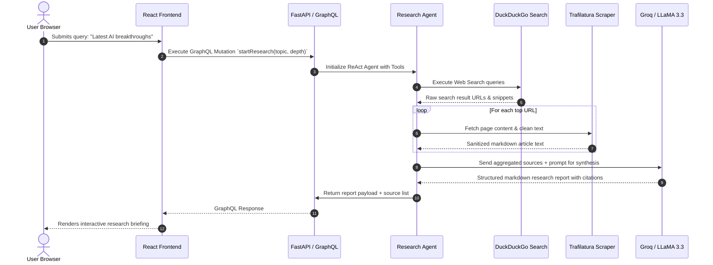
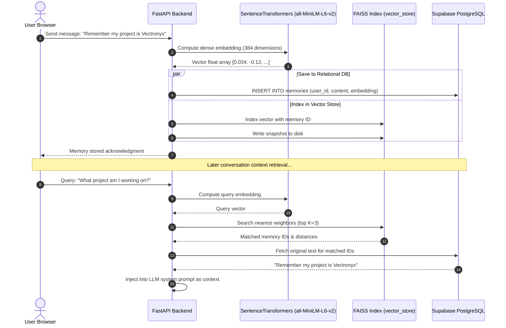

# Vectronyx AI Workbench — Architecture Blueprint

This document defines the architectural principles, component responsibilities, interaction flows, and technology selections that form **Vectronyx AI Workbench**.

---

## 1. High-Level System Architecture

Vectronyx is engineered as a hybrid cloud/local AI workstation. It couples a responsive single-page application (SPA) with an asynchronous FastAPI backend orchestrating autonomous agents, semantic vector stores, and relational persistence.

---

## 2. Core Architectural Layers

### 2.1 Presentation Layer (`frontend/`)
- **Framework**: React 18 with TypeScript running on Vite 5.
- **Styling**: Tailwind CSS v4 configured via `@tailwindcss/vite` for near-instant compilation and modern CSS variables.
- **State Management & Data Fetching**:
  - `@apollo/client` handles GraphQL queries and mutations with memory caching (`InMemoryCache`).
  - `@supabase/supabase-js` manages authentication, token persistence, and session lifecycle.
  - `react-hot-toast` displays non-intrusive feedback for network operations, auth states, and file uploads.
- **Navigation & Layout**:
  - `Layout.tsx` wraps all authenticated pages in a persistent shell.
  - `Header.tsx` provides brand identity, mobile drawer toggle, active user state, and profile/logout controls.
  - `Sidebar.tsx` supports a dual-state design: an expandable desktop sidebar with smooth micro-animations and a slide-over drawer with backdrop blur for mobile viewports.

### 2.2 API & Middleware Layer (`backend/app/api/` & `backend/app/middleware/`)
- **FastAPI Core**: Asynchronous ASGI framework handling HTTP and WebSocket traffic with low latency.
- **Strawberry GraphQL**: Code-first Python GraphQL library providing typed schemas, resolvers, and queries.
- **CORS Middleware**: Manages cross-origin headers, permitting secure communication with `http://localhost:5173` and dynamic development origins.
- **Authentication Routes**: Dedicated REST routes (`/auth/login`, `/auth/signup`) backed by Supabase table access with planned Supabase JWT validation.

### 2.3 Intelligence & Agent Layer (`backend/app/modules/`)
The intelligence tier hosts three decoupled specialized engines:

#### 1. Contextual Memory System (`backend/app/modules/memory/`)
- **Purpose**: Gives the LLM long-term conversational memory and contextual awareness across sessions.
- **Mechanism**:
  - Text inputs are converted into dense 384-dimensional vector embeddings using the `all-MiniLM-L6-v2` model from `sentence-transformers`.
  - Embeddings are indexed into a local `faiss-cpu` index for sub-millisecond similarity search (L2 distance or cosine similarity).
  - Raw texts, metadata, and timestamps are synced into the `memories` table in PostgreSQL.
  - When querying, the top-$K$ most relevant memory vectors are fetched and injected as system context into LLM prompts.

#### 2. Autonomous Research Agent (`backend/app/modules/research_agent/`)
- **Purpose**: Executes deep multi-step reasoning, web exploration, and content synthesis without manual search intervention.
- **Mechanism**:
  - Implements the **ReAct (Reason + Act)** pattern using `langchain`.
  - Queries `duckduckgo-search` for real-time web results.
  - Employs `trafilatura` and `beautifulsoup4` with `lxml` to strip boilerplate, ads, and navigation chrome, extracting pure article markdown.
  - Feeds gathered facts into LLaMA 3.3 (via Groq Cloud or Ollama) to synthesize comprehensive, cited research briefings.

#### 3. Intelligent Data Analyst (`backend/app/modules/data_analyst/`)
- **Purpose**: Converts natural language prompts into tabular data transformations, statistical analyses, anomaly checks, and visual charts.
- **Mechanism**:
  - Reads structured files (CSV, TSV, JSON) into `pandas` DataFrames.
  - Performs anomaly detection using `scikit-learn`'s `IsolationForest` or distribution heuristics.
  - Generates publication-ready figures using `matplotlib` and `seaborn`, outputting base64 data URIs or image assets directly to the frontend.
  - Translates user questions into dynamic statistical summaries (e.g., correlations, regressions, skewness).

### 2.4 Model & Inference Layer (`backend/app/services/`)
- **Groq Cloud API**: High-throughput inference for LLaMA 3.3 70B Versatile, providing low token-to-first-token latencies.
- **Ollama Client**: Local daemon integration (`http://localhost:11434`) for full privacy, offline operation, and zero API costs.
- **Embedding Provider**: In-process `SentenceTransformer` pipeline utilizing local CPU/GPU acceleration without third-party network dependencies.

### 2.5 Persistence & Vector Store Layer (`backend/app/db/` & `vector_store/`)
- **Relational Storage**: PostgreSQL hosted on Supabase, connected via SQLAlchemy 2.0 and Alembic.
  - Tables: `users` (credentials and metadata), `memories` (text content, embedding JSON, timestamps), `query_logs` (audit records of user prompts and agent responses).
- **Vector Storage**: File-based FAISS index (`vector_store/index.faiss` and `vector_store/index.pkl`), enabling persistence across server restarts.

---

## 3. Request Lifecycle Diagram

### 3.1 Research Agent Execution Flow

### 3.2 Memory Storage & Recall Flow

---

## 4. Key Architectural Decisions

| Decision | Rationale | Alternatives Considered |
| :--- | :--- | :--- |
| **Strawberry GraphQL over pure REST** | Strongly typed contract, granular field requests, self-documenting schema explorer at `/graphql`. | Pure REST (overfetching/underfetching), gRPC (poor browser ergonomics). |
| **Hybrid LLM (Groq + Ollama)** | Combines cloud speed (Groq) with local privacy/offline fallback (Ollama). | Pure OpenAI (high cost, lock-in), Pure Local (requires beefy GPU). |
| **Local FAISS over Cloud Vector DB** | Zero cost, ultra-low latency, no external network dependencies, simple local backup. | Pinecone (paid tier limits), Supabase pgvector (additional cloud setup needed). |
| **Tailwind CSS v4 + Vite** | Instant HMR, zero runtime overhead, modern CSS variables, clean responsive utilities. | Emotion/Styled-components (runtime penalty), Tailwind v3 (heavier config). |
| **Supabase Client + Python Backend** | Offloads client auth state handling, OAuth redirects, and session renewal while maintaining full backend data ownership. | Custom JWT auth from scratch (high maintenance, security risks). |
