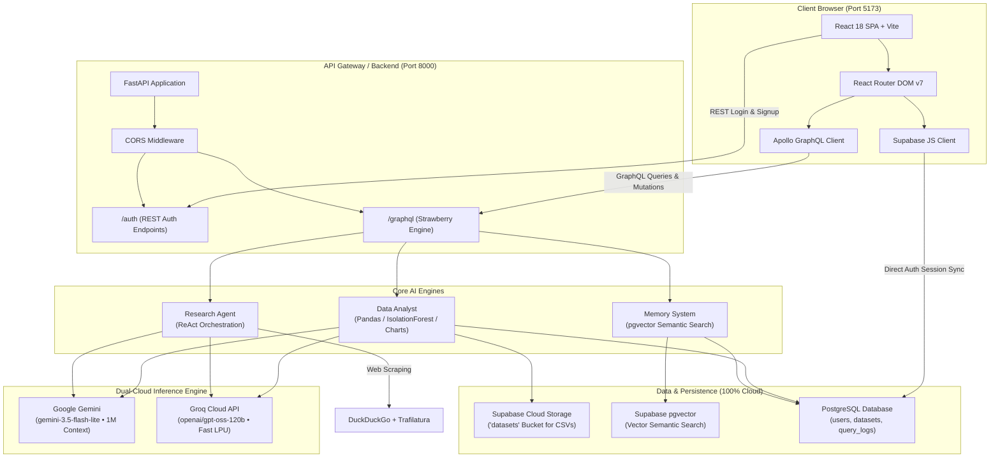
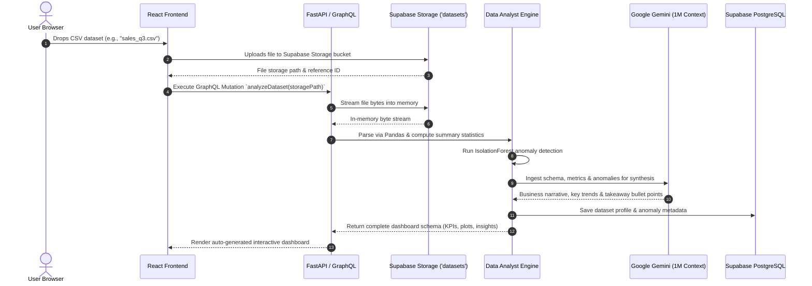
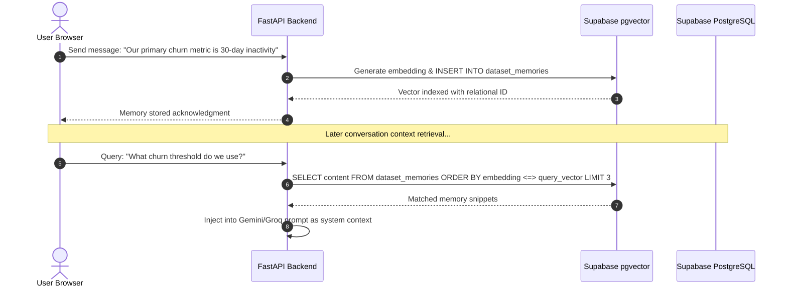

# Vectronyx AI Workbench — Architecture Blueprint

This document defines the architectural principles, component responsibilities, interaction flows, and technology selections that form **Vectronyx AI Workbench**.

---

## 1. High-Level System Architecture

Vectronyx is engineered as a hybrid cloud/local AI workstation. It couples a responsive single-page application (SPA) with an asynchronous FastAPI backend orchestrating autonomous agents, semantic vector stores, and relational persistence.

---

## 2. Core Architectural Layers

### 2.1 Presentation Layer (`frontend/`)
- **Framework**: React 18 with TypeScript running on Vite 5.
- **Styling**: Tailwind CSS v4 configured via `@tailwindcss/vite` for near-instant compilation and modern CSS variables.
- **State Management & Data Fetching**:
  - `@apollo/client` handles GraphQL queries and mutations with memory caching (`InMemoryCache`).
  - `@supabase/supabase-js` manages authentication, token persistence, and session lifecycle.
  - `react-hot-toast` displays non-intrusive feedback for network operations, auth states, and file uploads.
- **Navigation & Layout**:
  - `Layout.tsx` wraps all authenticated pages in a persistent shell.
  - `Header.tsx` provides brand identity, mobile drawer toggle, active user state, and profile/logout controls.
  - `Sidebar.tsx` supports a dual-state design: an expandable desktop sidebar with smooth micro-animations and a slide-over drawer with backdrop blur for mobile viewports.

### 2.2 API & Middleware Layer (`backend/app/api/` & `backend/app/middleware/`)
- **FastAPI Core**: Asynchronous ASGI framework handling HTTP and WebSocket traffic with low latency.
- **Strawberry GraphQL**: Code-first Python GraphQL library providing typed schemas, resolvers, and queries.
- **CORS Middleware**: Manages cross-origin headers, permitting secure communication with `http://localhost:5173` and dynamic development origins.
- **Authentication Routes**: Dedicated REST routes (`/auth/login`, `/auth/signup`) backed by Supabase table access with planned Supabase JWT validation.

### 2.3 Intelligence & Agent Layer (`backend/app/modules/`)
The intelligence tier hosts three decoupled specialized engines:

#### 1. Intelligent Data Analyst (`backend/app/modules/data_analyst/`)
- **Purpose**: Converts raw uploaded CSV datasets into thorough statistical profiles, multidimensional anomaly scores, and dynamic dashboards.
- **Mechanism**:
  - Streams raw files from Supabase Storage (`datasets` bucket) directly into memory streams (`pandas.read_csv()`) with zero disk writing.
  - Performs unsupervised mathematical outlier detection using Scikit-Learn’s `IsolationForest`.
  - Generates publication-ready figures using `matplotlib` and `seaborn`, outputting base64 data URIs or chart configurations directly to the frontend.
  - Translates natural language questions into dynamic statistical summaries (correlations, distributions, metrics).

#### 2. Contextual Memory System (`backend/app/modules/memory/`)
- **Purpose**: Gives the LLM long-term conversational memory, dataset schema awareness, and contextual intelligence across sessions.
- **Mechanism**:
  - Semantic embeddings are generated and stored in **Supabase `pgvector`** (768d / 384d).
  - Raw texts, metadata, user bindings, and timestamps are synced into PostgreSQL tables with indexed vector columns.
  - When querying, nearest-neighbor memory vectors (`<=>` cosine similarity) are fetched and injected as system context into LLM prompts.

#### 3. Autonomous Research Agent (`backend/app/modules/research_agent/`)
- **Purpose**: Executes deep multi-step reasoning, web exploration, and content synthesis without manual search intervention.
- **Mechanism**:
  - Implements the **ReAct (Reason + Act)** pattern using `langchain`.
  - Queries `duckduckgo-search` for real-time web results.
  - Employs `trafilatura` and `beautifulsoup4` with `lxml` to strip boilerplate, ads, and navigation chrome, extracting pure article markdown.
  - Feeds gathered facts into Gemini or Groq to synthesize comprehensive, cited research briefings.

### 2.4 Model & Inference Layer (`backend/app/services/`)
- **Google Gemini API**: Deep reasoning, code generation, and massive 1M token context window (`gemini-3.5-flash-lite`).
- **Groq Cloud API**: High-throughput LPU inference (`openai/gpt-oss-120b`) providing ~250 tokens/second sub-second delivery for conversational agent loops.

### 2.5 Persistence & Cloud Storage Layer (`backend/app/db/`)
- **Relational Storage**: PostgreSQL hosted on Supabase, connected via SQLAlchemy 2.0 and Alembic.
  - Tables: `users` (credentials and metadata), `datasets` (uploaded metadata, row/col counts, storage paths), `memories` (text content, vector embeddings, timestamps), `query_logs` (audit records).
- **Cloud File Storage**: Supabase Storage (`datasets` bucket) for raw dataset files with signed URL streaming.
- **Cloud Vector Store**: Supabase `pgvector` extension for cosine distance index searches.

---

## 3. Request Lifecycle Diagrams

### 3.1 AI Data Analyst Ingestion & Profiling Flow

### 3.2 Memory Storage & Recall Flow

---

## 4. Key Architectural Decisions

| Decision | Rationale | Alternatives Considered |
| :--- | :--- | :--- |
| **Strawberry GraphQL over pure REST** | Strongly typed contract, granular field requests, self-documenting schema explorer at `/graphql`. | Pure REST (overfetching/underfetching), gRPC (poor browser ergonomics). |
| **Dual-Cloud Inference (Gemini + Groq)** | Pairs Gemini’s massive 1M context reasoning with Groq’s sub-second (~250 tok/s) response speed. | Single proprietary provider (vendor lock-in, outage risk). |
| **Supabase pgvector over Local Files** | 100% cloud-native persistence, relational joins (`WHERE user_id = ...`), zero local `.index` files to manage. | Local FAISS files (cannot scale to multi-instance cloud deployments). |
| **Supabase Storage for CSV Ingestion** | 1GB free cloud storage, signed access tokens, direct in-memory streaming into Pandas without local disk I/O. | Local disk storage (stateful, ephemeral in containers), AWS S3 (requires extra credentials). |
| **Tailwind CSS v4 + Vite** | Instant HMR, zero runtime overhead, modern CSS variables, clean responsive utilities. | Emotion/Styled-components (runtime penalty), Tailwind v3 (heavier config). |
| **Supabase Client + Python Backend** | Offloads client auth state handling, OAuth redirects, and session renewal while maintaining full backend data ownership. | Custom JWT auth from scratch (high maintenance, security risks). |

