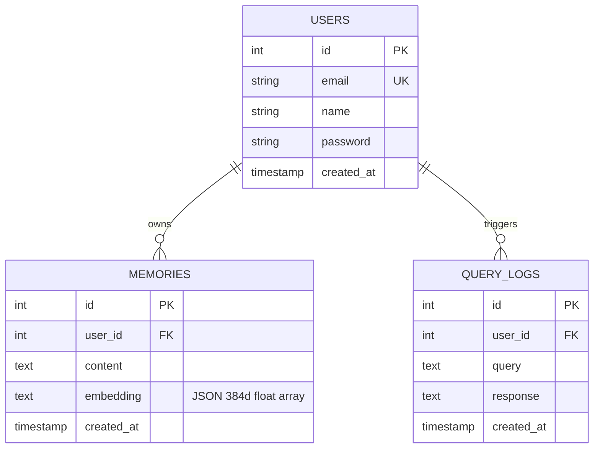

# Vectronyx AI Workbench — Database & Vector Store Schema

This document details the relational PostgreSQL schema, SQLAlchemy models, Alembic migration workflows, and the FAISS vector store architecture.

---

## 1. Entity Relationship (ER) Diagram



---

## 2. Relational Database Tables

### 2.1 `users` Table
Stores registered platform accounts, profiles, and authentication links.

- **Schema**: `public`
- **Table Name**: `users`
- **Model File**: `backend/app/db/models/user.py`

| Column | Type | Constraints | Description |
| :--- | :--- | :--- | :--- |
| `id` | `INTEGER` | `PRIMARY KEY`, Auto-increment | Unique identifier for the user. |
| `email` | `VARCHAR(255)` | `UNIQUE`, `INDEX`, `NOT NULL` | User email address for credentials and communication. |
| `name` | `VARCHAR(255)` | `NULLABLE` | Display name / full name. |
| `password` | `VARCHAR(255)` | `NULLABLE` | Hashed password (Bcrypt) when using local credentials. |
| `created_at` | `TIMESTAMPTZ` | `DEFAULT NOW()` | Record creation timestamp. |

---

### 2.2 `memories` Table
Stores raw text chunks, memory metadata, and relational links to users.

- **Schema**: `public`
- **Table Name**: `memories`
- **Model File**: `backend/app/db/models/memory.py`

| Column | Type | Constraints | Description |
| :--- | :--- | :--- | :--- |
| `id` | `INTEGER` | `PRIMARY KEY`, Auto-increment | Unique memory identifier. |
| `user_id` | `INTEGER` | `FOREIGN KEY (users.id)` | Owner of the memory note. |
| `content` | `TEXT` | `NOT NULL` | Raw memory text / statement. |
| `embedding` | `TEXT` | `NULLABLE` | Serialized JSON string of the 384-dimensional vector. |
| `created_at` | `TIMESTAMPTZ` | `DEFAULT NOW()` | Record creation timestamp. |

---

### 2.3 `query_logs` Table
Maintains an audit trail of user queries, agent prompts, and generated responses.

- **Schema**: `public`
- **Table Name**: `query_logs`
- **Model File**: `backend/app/db/models/query_log.py`

| Column | Type | Constraints | Description |
| :--- | :--- | :--- | :--- |
| `id` | `INTEGER` | `PRIMARY KEY`, Auto-increment | Unique log entry identifier. |
| `query` | `TEXT` | `NOT NULL` | User input query / prompt. |
| `response` | `TEXT` | `NOT NULL` | Model response or agent synthesis output. |
| `created_at` | `TIMESTAMPTZ` | `DEFAULT NOW()` | Execution timestamp. |

---

## 3. FAISS Vector Store Architecture

While PostgreSQL holds relational and textual records, vector similarity search is offloaded to a high-performance **FAISS (Facebook AI Similarity Search)** index.

```
vector_store/
├── index.faiss    # Native binary representation of the FAISS vector index
└── index.pkl      # Pickled dictionary mapping FAISS internal IDs to relational Memory IDs
```

### 3.1 Technical Specifications

| Parameter | Specification | Details |
| :--- | :--- | :--- |
| **Model** | `all-MiniLM-L6-v2` | Sentence-Transformers architecture. |
| **Embedding Dimensions** | `384` | Balanced precision and memory footprint. |
| **Index Algorithm** | `IndexFlatL2` | Exact Euclidean distance search; zero quantization loss. |
| **Persistence Method** | File serialization | `faiss.write_index()` & `faiss.read_index()`. |
| **Sync Strategy** | Two-phase commit | Relational record saved first $\to$ Vector added to FAISS and snapshot saved to disk. |

---

## 4. Alembic Migration Lifecycle

Database migrations are managed via **Alembic** (`backend/alembic/`).

### 4.1 Applying Migrations
To upgrade the database to the latest schema:
```bash
cd backend
alembic upgrade head
```

### 4.2 Creating a New Migration
When modifying or adding models in `backend/app/db/models/`:
```bash
cd backend
alembic revision --autogenerate -m "Add updated column constraints"
```

### 4.3 Rolling Back
To rollback the most recent migration step:
```bash
cd backend
alembic downgrade -1
```

---

## 5. Supabase Integration Notes

Vectronyx uses Supabase PostgreSQL as its managed database:
- **Direct Connection Pooling**: Connected on port `5432` via `DATABASE_URL` in `backend/.env`.
- **Row Level Security (RLS)**: Can be enabled on `public.users` and `public.memories` using Supabase policies.
- **Client Access**: The frontend communicates via `VITE_SUPABASE_URL` and `VITE_SUPABASE_PUBLISHABLE_KEY`, while the backend holds elevated permissions via `SUPABASE_SERVICE_ROLE_KEY`.
