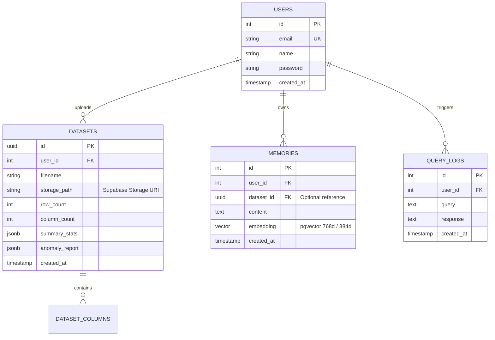

# Vectronyx AI Workbench — Database & Vector Store Schema

This document details the relational PostgreSQL schema, SQLAlchemy models, Alembic migration workflows, and the FAISS vector store architecture.

---

## 1. Entity Relationship (ER) Diagram



---

## 2. Relational Database Tables

### 2.1 `users` Table
Stores registered platform accounts, profiles, and authentication links.

- **Schema**: `public`
- **Table Name**: `users`
- **Model File**: `backend/app/db/models/user.py`

| Column | Type | Constraints | Description |
| :--- | :--- | :--- | :--- |
| `id` | `INTEGER` | `PRIMARY KEY`, Auto-increment | Unique identifier for the user. |
| `email` | `VARCHAR(255)` | `UNIQUE`, `INDEX`, `NOT NULL` | User email address for credentials and communication. |
| `name` | `VARCHAR(255)` | `NULLABLE` | Display name / full name. |
| `password` | `VARCHAR(255)` | `NULLABLE` | Hashed password (Bcrypt) when using local credentials. |
| `created_at` | `TIMESTAMPTZ` | `DEFAULT NOW()` | Record creation timestamp. |

---

### 2.2 `datasets` Table
Tracks uploaded tabular datasets stored in Supabase Cloud Storage.

- **Schema**: `public`
- **Table Name**: `datasets`
- **Model File**: `backend/app/db/models/dataset.py`

| Column | Type | Constraints | Description |
| :--- | :--- | :--- | :--- |
| `id` | `UUID` | `PRIMARY KEY`, `DEFAULT gen_random_uuid()` | Unique dataset identifier. |
| `user_id` | `INTEGER` | `FOREIGN KEY (users.id)` | Owner of the dataset. |
| `filename` | `VARCHAR(255)` | `NOT NULL` | Original uploaded file name. |
| `storage_path` | `VARCHAR(500)` | `NOT NULL` | Storage bucket object key in Supabase Storage (`datasets/...`). |
| `row_count` | `INTEGER` | `DEFAULT 0` | Total number of parsed rows. |
| `column_count` | `INTEGER` | `DEFAULT 0` | Total number of parsed columns. |
| `summary_stats` | `JSONB` | `DEFAULT '{}'` | Output of automated Pandas statistical profiling. |
| `anomaly_report` | `JSONB` | `DEFAULT '{}'` | Outlier detection metrics from Isolation Forest. |
| `created_at` | `TIMESTAMPTZ` | `DEFAULT NOW()` | Ingestion timestamp. |

---

### 2.3 `memories` Table (`pgvector` Augmented)
Stores text statements, dataset schemas, analytical takeaways, and their vector embeddings.

- **Schema**: `public`
- **Table Name**: `memories`
- **Model File**: `backend/app/db/models/memory.py`

| Column | Type | Constraints | Description |
| :--- | :--- | :--- | :--- |
| `id` | `INTEGER` | `PRIMARY KEY`, Auto-increment | Unique memory identifier. |
| `user_id` | `INTEGER` | `FOREIGN KEY (users.id)` | Owner of the memory note. |
| `dataset_id` | `UUID` | `FOREIGN KEY (datasets.id)`, `NULLABLE` | Optional dataset reference binding. |
| `content` | `TEXT` | `NOT NULL` | Raw memory text / statement. |
| `embedding` | `VECTOR(768)` | `NULLABLE` | Native PostgreSQL vector for cosine distance similarity (`<=>`). |
| `created_at` | `TIMESTAMPTZ` | `DEFAULT NOW()` | Record creation timestamp. |

---

### 2.4 `query_logs` Table
Maintains an audit trail of user queries, agent prompts, and generated responses.

- **Schema**: `public`
- **Table Name**: `query_logs`
- **Model File**: `backend/app/db/models/query_log.py`

| Column | Type | Constraints | Description |
| :--- | :--- | :--- | :--- |
| `id` | `INTEGER` | `PRIMARY KEY`, Auto-increment | Unique log entry identifier. |
| `user_id` | `INTEGER` | `FOREIGN KEY (users.id)` | User executing the query. |
| `query` | `TEXT` | `NOT NULL` | User input query / prompt. |
| `response` | `TEXT` | `NOT NULL` | Model response or agent synthesis output. |
| `created_at` | `TIMESTAMPTZ` | `DEFAULT NOW()` | Execution timestamp. |

---

## 3. Supabase Cloud Storage & `pgvector` Architecture

Instead of local binary `.index` files on disk, Vectronyx operates 100% in the cloud:

```
Supabase Cloud Project
├── Storage Bucket: 'datasets'  ──► Stores raw CSVs; streamed to Pandas in-memory
└── PostgreSQL with pgvector    ──► Native vector indexing (HNSW / Cosine <=>)
```

### 3.1 Technical Specifications

| Parameter | Specification | Details |
| :--- | :--- | :--- |
| **Vector Extension** | `pgvector` | Native PostgreSQL extension enabled via `CREATE EXTENSION IF NOT EXISTS vector;`. |
| **Vector Dimensions** | `768` (or `384`) | Compatible with Google Gemini embeddings and MiniLM. |
| **Distance Metric** | Cosine Distance (`<=>`) | Normalized angular similarity for semantic text comparisons. |
| **Index Type** | `HNSW` (Hierarchical Navigable Small World) | Sub-millisecond approximate nearest-neighbor retrieval. |
| **Dataset Storage** | Supabase Storage (`datasets`) | Cloud object store with signed URL streaming directly into Pandas. |


---

## 4. Alembic Migration Lifecycle

Database migrations are managed via **Alembic** (`backend/alembic/`).

### 4.1 Applying Migrations
To upgrade the database to the latest schema:
```bash
cd backend
alembic upgrade head
```

### 4.2 Creating a New Migration
When modifying or adding models in `backend/app/db/models/`:
```bash
cd backend
alembic revision --autogenerate -m "Add updated column constraints"
```

### 4.3 Rolling Back
To rollback the most recent migration step:
```bash
cd backend
alembic downgrade -1
```

---

## 5. Supabase Integration Notes

Vectronyx uses Supabase PostgreSQL as its managed database:
- **Direct Connection Pooling**: Connected on port `5432` via `DATABASE_URL` in `backend/.env`.
- **Row Level Security (RLS)**: Can be enabled on `public.users` and `public.memories` using Supabase policies.
- **Client Access**: The frontend communicates via `VITE_SUPABASE_URL` and `VITE_SUPABASE_PUBLISHABLE_KEY`, while the backend holds elevated permissions via `SUPABASE_SERVICE_ROLE_KEY`.
