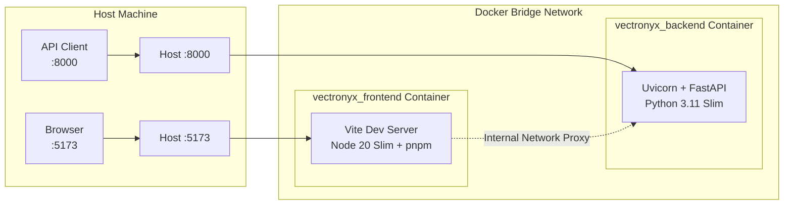

# Vectronyx AI Workbench — Docker & Infrastructure Guide

This guide details the containerization architecture, Dockerfiles, Docker Compose configuration, live volume syncing, and deployment workflows for **Vectronyx**.

---

## 1. Container Architecture Overview

Vectronyx is packaged as a two-tier containerized stack orchestrated via Docker Compose:



---

## 2. Dockerfiles Analysis

### 2.1 Backend Dockerfile (`backend/Dockerfile`)

```dockerfile
FROM python:3.11-slim

# Prevent Python from buffering logs
ENV PYTHONDONTWRITEBYTECODE=1
ENV PYTHONUNBUFFERED=1

WORKDIR /app

# Install system dependencies (needed for psycopg2 compilation etc.)
RUN apt-get update && apt-get install -y \
    gcc \
    libpq-dev \
    && rm -rf /var/lib/apt/lists/*

# Install Python dependencies with layer caching
COPY requirements.txt .
RUN pip install --no-cache-dir -r requirements.txt

# Copy project files
COPY . .

# Expose port
EXPOSE 8000

# Run FastAPI via Uvicorn
CMD ["uvicorn", "app.middleware.app:app", "--host", "0.0.0.0", "--port", "8000"]
```

**Key Optimizations**:
- **Slim Base**: Uses Debian-based `python:3.11-slim` to minimize image size while maintaining glibc compatibility for compiled wheels (`numpy`, `faiss-cpu`, `scipy`).
- **Layer Caching**: Dependency installation is decoupled from code changes (`COPY requirements.txt .` first), ensuring rapid container rebuilds when only source files change.
- **Log Flushing**: `PYTHONUNBUFFERED=1` guarantees real-time terminal log delivery without buffering delay.

---

### 2.2 Frontend Dockerfile (`frontend/Dockerfile`)

```dockerfile
FROM node:20-slim

# Enable pnpm via Corepack
RUN corepack enable && corepack prepare pnpm@9.12.2 --activate

WORKDIR /app

# Copy lock + package files
COPY package.json pnpm-lock.yaml ./

# Install dependencies
RUN pnpm install

# Copy rest of the application
COPY . .

# Expose Vite dev port
EXPOSE 5173

# Run Vite dev server with external host binding
CMD ["pnpm", "run", "dev", "--", "--host"]
```

**Key Optimizations**:
- **Corepack Integration**: Automatically provisions `pnpm@9.12.2` without global npm bloat.
- **Host Binding**: Passing `--host` allows Vite to listen on `0.0.0.0`, ensuring traffic from the host machine reaches the container.

---

## 3. Docker Compose Orchestration (`infra/docker-compose.yml`)

```yaml
services:
  backend:
    build: ../backend
    container_name: vectronyx_backend
    ports:
      - "8000:8000"
    env_file:
      - ../backend/.env
    volumes:
      - ../backend:/app
    restart: always

  frontend:
    build: ../frontend
    container_name: vectronyx_frontend
    ports:
      - "5173:5173"
    depends_on:
      - backend
    volumes:
      - ../frontend:/app
      - /app/node_modules
    environment:
      - CHOKIDAR_USEPOLLING=true
    command: pnpm run dev -- --host
    restart: always
```

### 3.1 Live Development Features
- **Volume Mounts**: `../backend:/app` and `../frontend:/app` mount host files directly into containers. Edits saved on the host trigger instant Hot Module Replacement (HMR) or Uvicorn reloads.
- **Anonymous Volume**: `- /app/node_modules` preserves container-installed dependencies from being overwritten by the host machine's directory.
- **Polling Watcher**: `CHOKIDAR_USEPOLLING=true` guarantees file change detection across Windows, WSL, and Docker filesystem boundaries.

---

## 4. Docker CLI Cheat Sheet

### Starting Services
```bash
cd infra

# Start in foreground (with logs)
docker compose up --build

# Start in background (detached)
docker compose up -d --build
```

### Monitoring & Logs
```bash
# View aggregated live logs
docker compose logs -f

# View backend logs only
docker compose logs -f backend

# View frontend logs only
docker compose logs -f frontend
```

### Executing Commands in Containers
```bash
# Open interactive shell in backend
docker exec -it vectronyx_backend bash

# Run Alembic migrations inside container
docker exec -it vectronyx_backend alembic upgrade head

# Install a new Python package inside container
docker exec -it vectronyx_backend pip install <package-name>
```

### Stopping & Cleaning Up
```bash
# Stop containers
docker compose stop

# Remove containers and networks
docker compose down

# Remove containers, networks, and persistent volumes
docker compose down -v
```

---

## 5. Production Deployment Best Practices

When transitioning from development to production:
1. **Frontend Static Serving**: Build the production bundle (`pnpm run build`) and serve via Nginx Alpine container rather than Vite dev server.
2. **Backend Production Runner**: Replace single-process Uvicorn reload with Gunicorn managing multiple worker processes:
   ```bash
   gunicorn -k uvicorn.workers.UvicornWorker app.middleware.app:app -w 4 -b 0.0.0.0:8000
   ```
3. **Environment Security**: Never commit `.env` files into source control or Docker images. Use Docker secrets or cloud secret managers.
