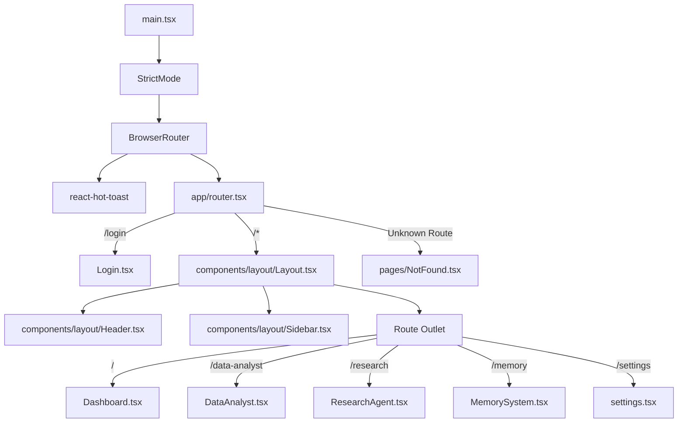
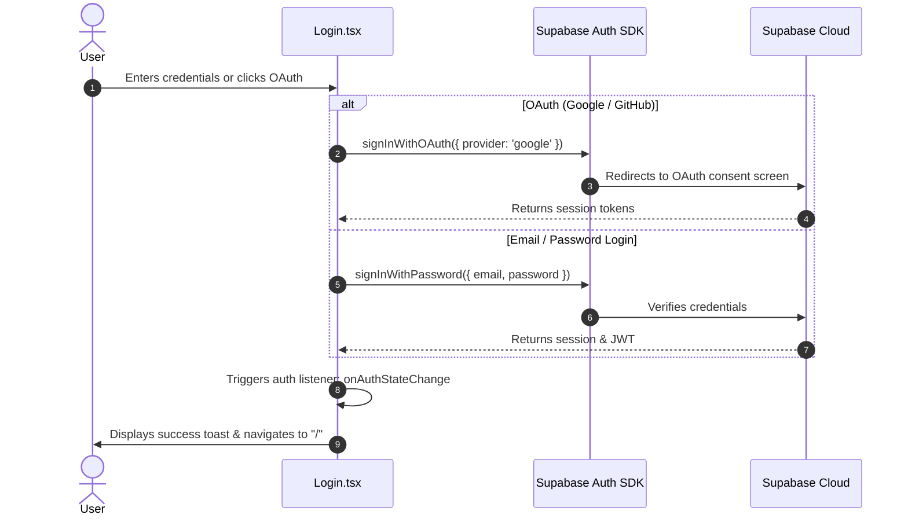

# Vectronyx AI Workbench — Frontend Architecture & Development Guide

This guide details the frontend architecture, component tree, routing strategy, styling conventions, and state integration for **Vectronyx**.

---

## 1. Technology Stack

| Technology | Version | Purpose |
| :--- | :--- | :--- |
| **React** | `18.3.1` | Declarative UI component tree |
| **Vite** | `5.4.2` | Fast bundling and instant Hot Module Replacement (HMR) |
| **TypeScript** | `5.5.3` | Static type safety across components and services |
| **Tailwind CSS** | `4.2.2` | Modern utility-first CSS via `@tailwindcss/vite` |
| **React Router** | `7.14.0` | Client-side routing, nested routes, and layouts |
| **Apollo Client** | `4.1.7` | GraphQL client caching and query execution |
| **Supabase JS** | `2.105.3` | Client-side auth, OAuth listeners, and user state |
| **React Hot Toast**| `2.6.0` | Non-blocking notification toasts |
| **Lucide & React Icons**| `1.8.0` / `5.6.0` | Iconography |

---

## 2. Directory Structure (`frontend/src/`)

```
src/
├── App.tsx                     # Top-level shell component
├── main.tsx                    # React DOM root, Router & Toaster mounting
├── index.css                   # Global CSS & Tailwind directive
├── app/
│   └── router.tsx              # Application routing definitions
├── components/
│   └── layout/
│       ├── Header.tsx          # Top navigation bar & user profile dropdown
│       ├── Sidebar.tsx         # Desktop expandable sidebar & mobile drawer
│       └── Layout.tsx          # Main authenticated shell wrapper
├── features/
│   ├── auth/
│   │   └── Login.tsx           # Email/Password + OAuth (Google/GitHub) authentication
│   ├── dashboard/
│   │   └── Dashboard.tsx       # System telemetry, metrics, activity charts, overview cards
│   ├── data-analyst/
│   │   └── DataAnalyst.tsx     # Tabular data uploader and interactive query engine
│   ├── memory/
│   │   └── MemorySystem.tsx    # Semantic memory management & recall inspector
│   ├── research/
│   │   └── ResearchAgent.tsx   # Autonomous research query interface & report viewer
│   └── settings/
│       └── settings.tsx        # Workbench configuration & user preferences
├── lib/
│   ├── apollo.ts               # Apollo Client HTTP link and cache configuration
│   └── supabase.ts             # Supabase client instantiation and session rules
├── pages/
│   └── NotFound.tsx            # 404 fallback page
└── types/                      # Shared TypeScript interface definitions
```

---

## 3. Component Hierarchy & Routing



### 3.1 Layout & Navigation Mechanics
- **Layout Shell (`Layout.tsx`)**: Controls global viewport padding (`pt-16 md:pl-16`) to ensure fixed headers and sidebars do not overlap page contents.
- **Desktop Sidebar**:
  - Compact state (width `16` / `4rem`) displaying icons only.
  - Hover expanded state (width `60` / `15rem`) smoothly revealing navigation labels with transitions.
- **Mobile Slide-Over Drawer**:
  - Activated via hamburger icon in `Header.tsx`.
  - Slides in from the left (`translate-x-0`) with a dimmed backdrop overlay (`bg-black/30`).
  - Automatically dismisses upon clicking navigation links or the close button (`FiX`).

---

## 4. Authentication Architecture (`Login.tsx` & `supabase.ts`)



### 4.1 Client Authentication Best Practices
- **Session Auto-Refresh**: Configured in `frontend/src/lib/supabase.ts` with `autoRefreshToken: true` and `persistSession: true`.
- **Dynamic User Identification**: `Header.tsx` subscribes to `supabase.auth.onAuthStateChange`, dynamically updating user initials in the top right avatar button.

---

## 5. Styling Guidelines & Visual Tokens

The frontend uses a cohesive design palette:

- **Primary Accent**: Purple/Violet (`text-purple-600`, `bg-purple-500`, `#6d28d9`).
- **Active Navigation Pill**: `#f3e8ff` background with `#6d28d9` font color.
- **Surface Elevation**: Rounded cards (`rounded-xl`) with soft diffusion shadows (`shadow-[0_4px_20px_rgba(0,0,0,0.05)]`).
- **Translucency**: Glassmorphism applied to navigation headers (`bg-white/80 backdrop-blur-md`).
- **Responsive Breakpoint**: `md` (768px) is the primary dividing line between mobile drawer navigation and the collapsible desktop sidebar.
